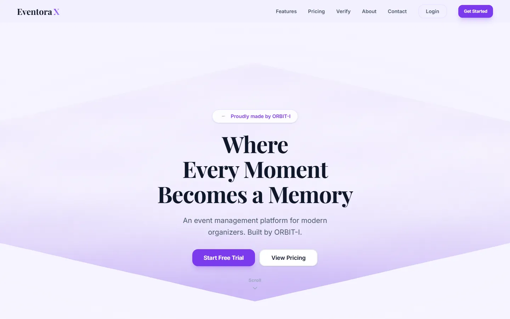
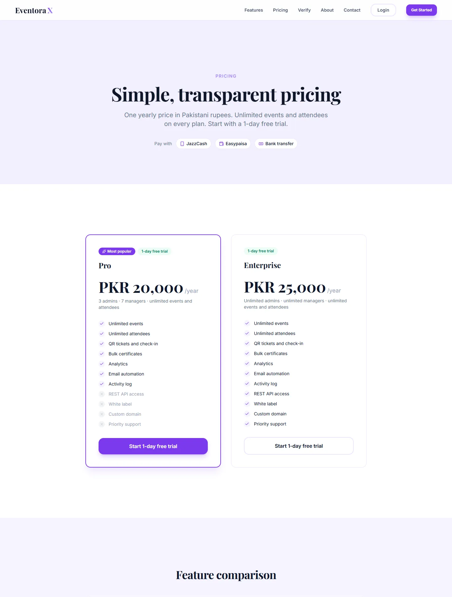
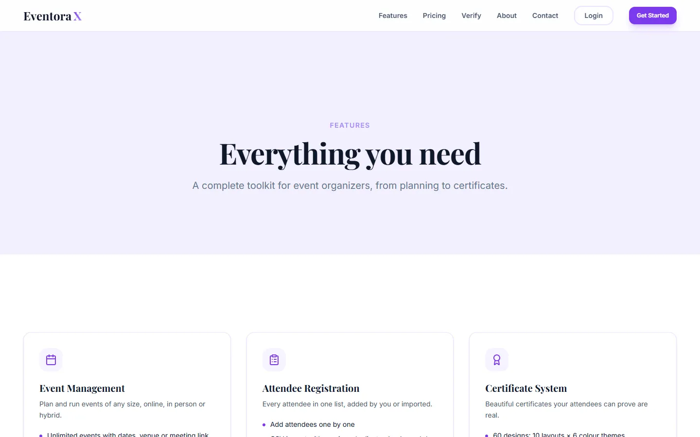
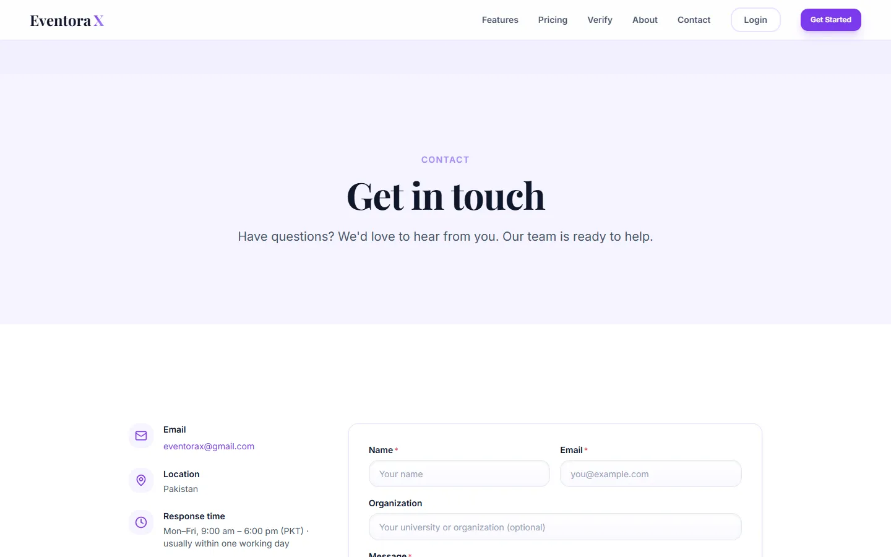
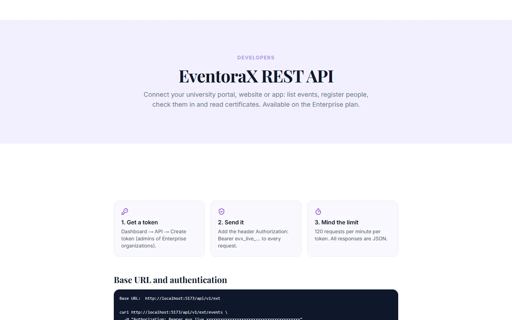
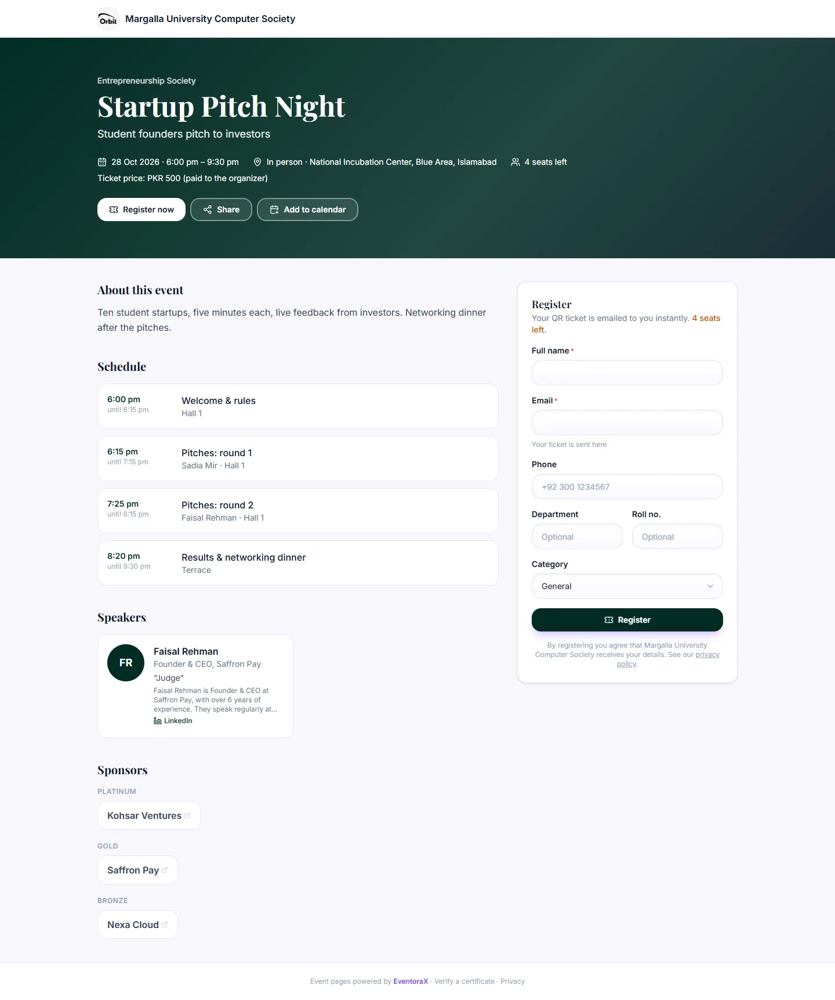
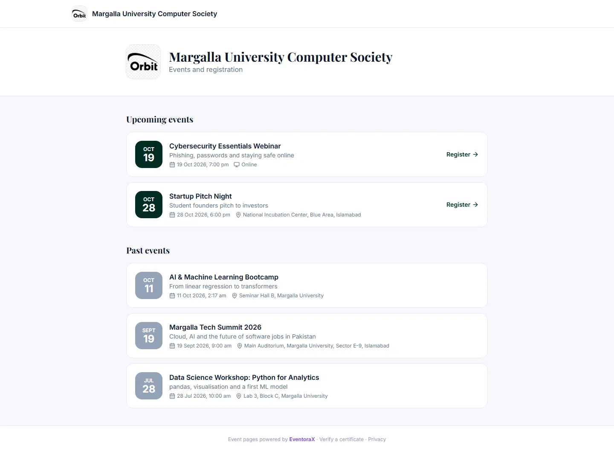
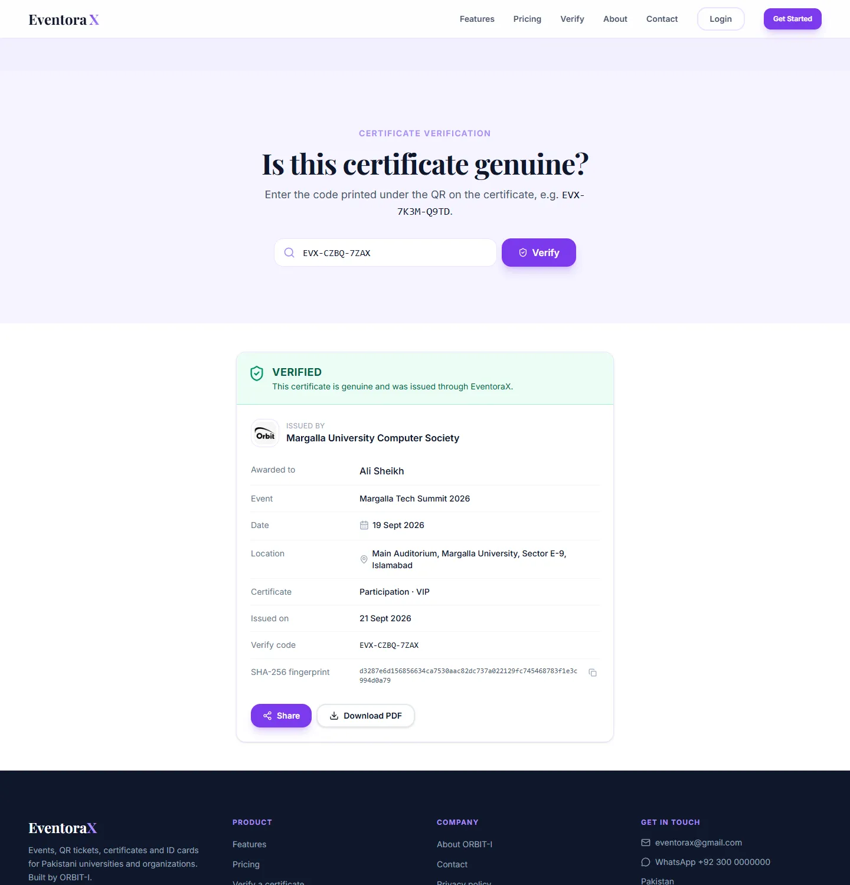

# 1. Public pages

These pages are open to everyone, without an account.

## The website

The home page explains what EventoraX does. From the top menu you reach **Features**, **Pricing**, **Verify** (check a
certificate), **About** and **Contact**. **Get Started** creates an organization; **Login** is for existing teams.

### Pricing

The plans with their yearly price in PKR, what each includes, how long the free trial is, the accepted payment methods
(JazzCash, Easypaisa, bank transfer), a feature-by-feature comparison and answers to common billing questions.
Plans are paid once a year and never renew by themselves.

### Features

A tour of everything the product does, grouped by area.

### Contact

Send a message to the EventoraX team, or use the email, WhatsApp and support hours shown next to the form.
To prevent spam, a person can send up to five messages an hour.

### API documentation

**Developers** (linked as "API docs" in the footer) is the reference for organizations on the Enterprise plan that want to
connect their own systems. See [API tokens](09-organization.md#api-enterprise-plan).

---

## Event pages and registering (for attendees)

Every published event has its own page at an address like `your-site/e/…`. Organizers share this link or print its QR
code on posters.

The page shows, in the organization's own colours:

- the title, organizer, date and time, the venue (for online events: "the link is on your ticket"), seats left and the
  ticket price if there is one;
- the description, schedule, speakers and sponsors the organizer chose to make public;
- **Share** (send the link) and **Add to calendar** (adds the event to your phone or computer calendar).

**To register:**

1. Fill in your full name and email (required). Phone, department, roll number and category are optional or chosen from a list.
2. Click **Register**.
3. Your **QR ticket appears on the screen** straight away, and the same ticket arrives by email as a PDF.
4. On the event day, show the QR code (on your phone or printed) at the entrance.

**Good to know**

- You can register only once per email address. Trying again says you're already registered.
- If the event is full, closed or over, the page says so instead of showing the form.
- The organizer receives your details. The online meeting link (for online events) is only on your ticket.

### Organization page

Each organization has a page at `your-site/o/<name>` listing its upcoming events (with a **Register** button) and past events.

---

## Verifying a certificate

Every certificate has a QR code and a verify code such as `EVX-CZBQ-7ZAX`. Employers, universities or anyone else can
check it is genuine:

1. Scan the QR on the certificate, **or** open **Verify** in the website menu and type the code.
2. Click **Verify**.

- **VERIFIED** (green): the certificate is genuine. You see who issued it, who it was awarded to, the event and the date,
  and you can download the original PDF.
- **REVOKED** (red): the organization withdrew this certificate. The reason is shown.
- **Not found**: the code is wrong or the certificate was never issued through EventoraX.

Email addresses and phone numbers are never shown on this page.
