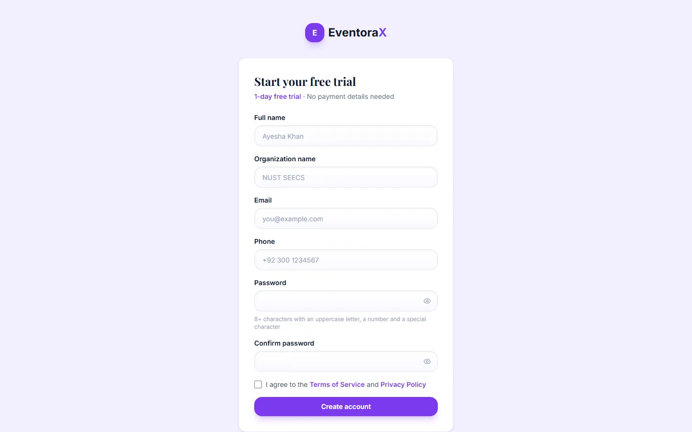
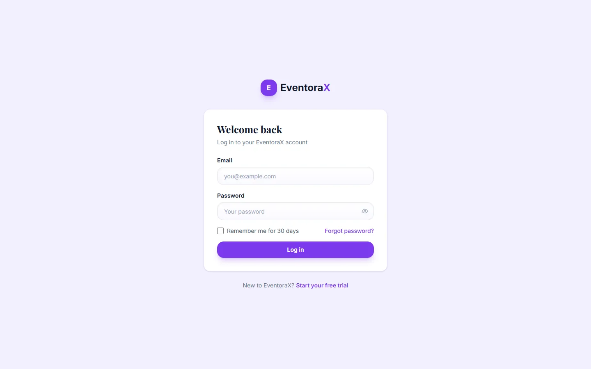
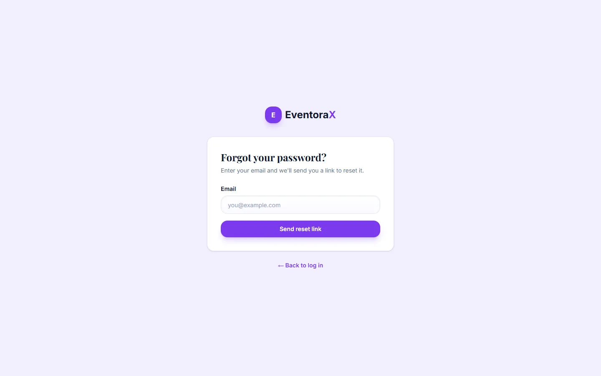
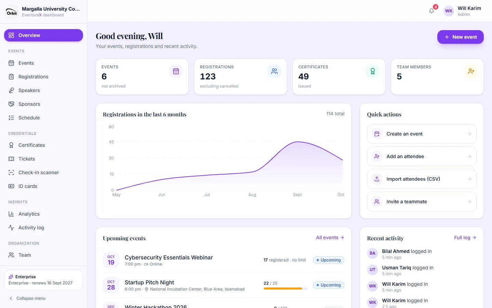
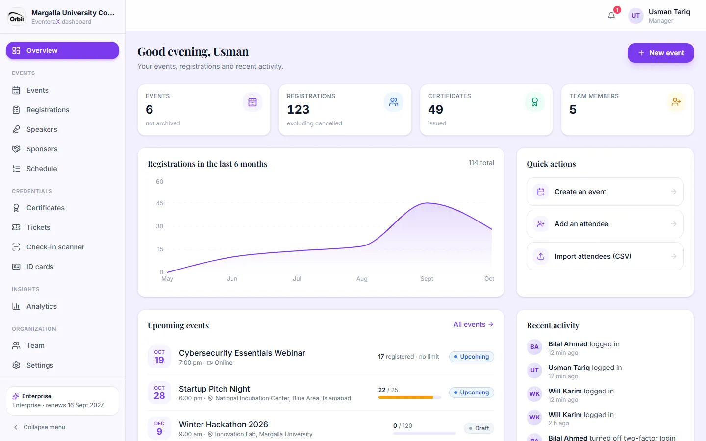
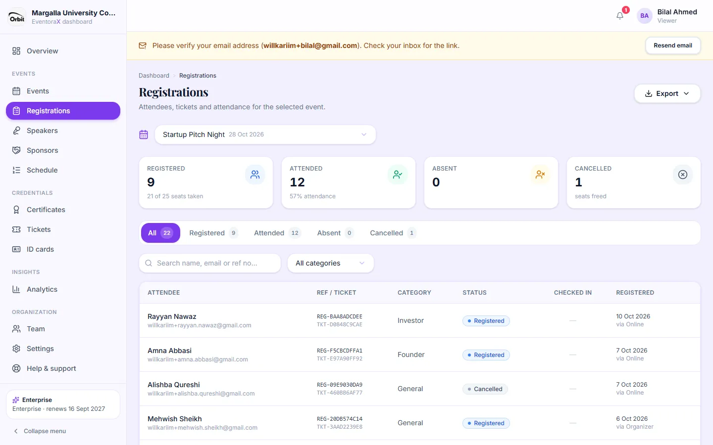
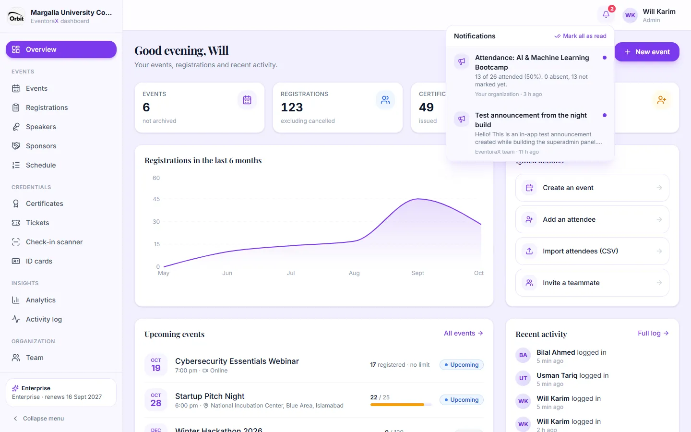

# 2. Getting started

## Create your organization

1. On the website click **Get Started** (or **Start Free Trial**).
2. Enter your name, your organization's name, email, phone and a password (at least 8 characters with an uppercase
   letter, a number and a special character).
3. Tick that you agree to the Terms and Privacy Policy and click **Create account**.
4. You go straight to your dashboard. Check your inbox and click the link to **verify your email**; until you do, a
   yellow strip at the top reminds you (with **Resend email**).

You start with a **free trial of the Pro plan**. Its length is shown on the sign-up page. You become the organization's
first **admin**.

## Log in

- Enter your email and password. Tick **Remember me** on your own computer to stay logged in.
- After **5 wrong passwords in 15 minutes** the account is locked for 15 minutes, to stop people guessing.
- If you turned on **two-factor login**, a second step asks for the 6-digit code from your phone
  (see [My account](09-organization.md#my-account)).

### Forgot your password?

Click **Forgot password?** on the login page, enter your email and open the link you receive (valid for 15 minutes).
Choose a new password. For your safety, you are logged out on every other device.

### Joining a team

If an admin invited you, you get an email with an **Accept invite** link (valid for 7 days). Open it, choose your name
and password, and you're in with the role the admin picked.

## The dashboard

**Overview** is the first page after logging in: your number of events, registrations, certificates and team members,
registrations over the last six months, quick actions, upcoming events and recent activity.

- **Left menu:** grouped into Events, Credentials, Insights and Organization. **Collapse menu** at the bottom makes it
  narrow. The card above it shows your plan and when it renews.
- **Top right:** the bell (notifications) and your name. Click your name for your account settings and **Log out**.
- On a phone, the menu opens from the button at the top left.

### What managers and viewers see

Managers see the same dashboard without the admin-only pages (Activity log, Billing, API). Viewers also don't see the
check-in scanner or any create, edit or delete buttons, for example on Registrations:

## Notifications

The bell shows how many unread notifications you have. Click it to see the latest ones; click a notification to read it in
full or to open the page it's about. **Mark all as read** clears the count. You get notifications for:

- announcements from the EventoraX team;
- new registrations from your public event pages, attendance summaries after events, finished certificate emails
  (admins, and only if switched on in [Settings → Notifications](09-organization.md#notifications)).

## Trial, expiry and suspension

A banner at the top of the dashboard tells you when your trial or plan is about to end. Admins also get an email
**3 days before** the end date.

When the plan **expires**, nothing is deleted. Overview, Billing, Settings and Help & support keep working so you can
pay; the other pages are locked until the payment is confirmed. See [Billing](09-organization.md#billing).

If the EventoraX team **suspends** an organization, its members can't log in and see the reason the team gave.

## Things that work the same everywhere

- **Event picker:** pages that work on one event (Registrations, Speakers, Certificates, Tickets…) have an event picker at
  the top. Your choice is remembered when you move between pages.
- **Filters and search** are kept in the page address, so you can bookmark or share a filtered view.
- **Unsaved changes:** if you try to leave a form you've changed, you're asked first.
- **Undo:** many quick actions (hiding a speaker, changing a status) show a message with **Undo** for a few seconds.
- **Dangerous actions** (delete, revoke, cancel) always ask you to confirm first.
