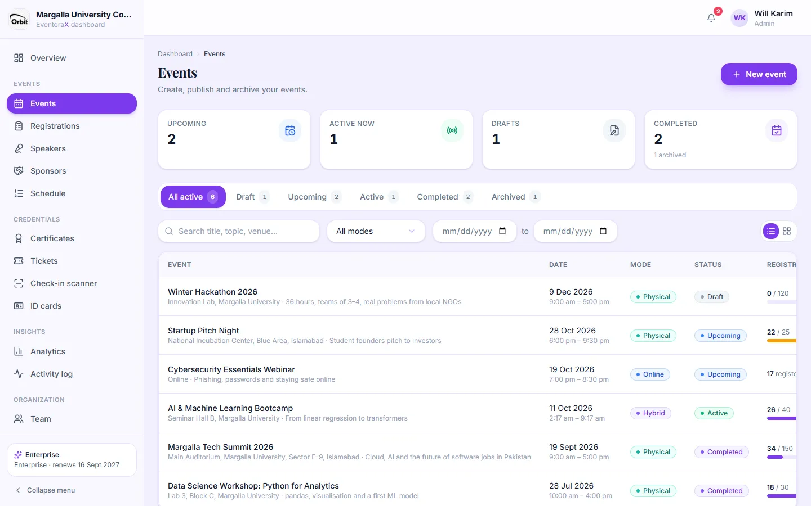
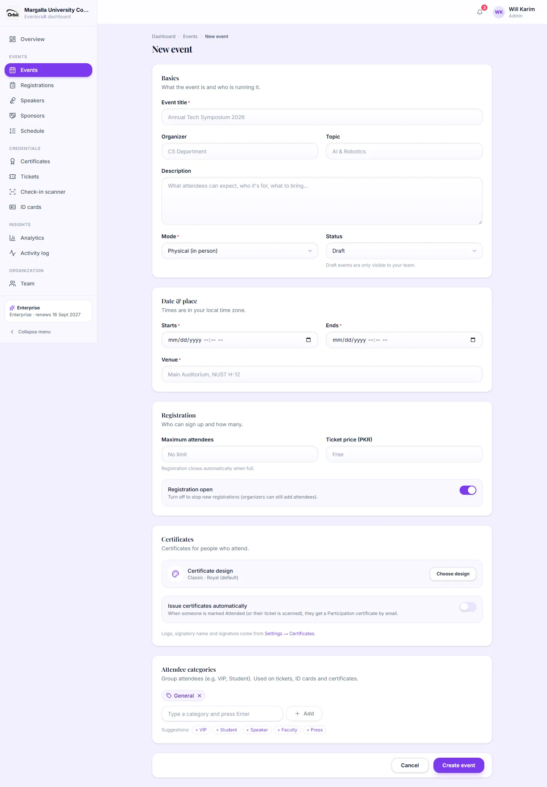
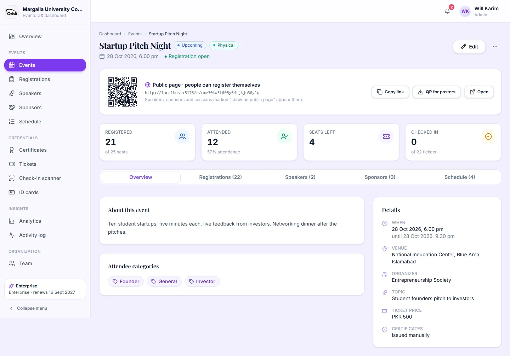
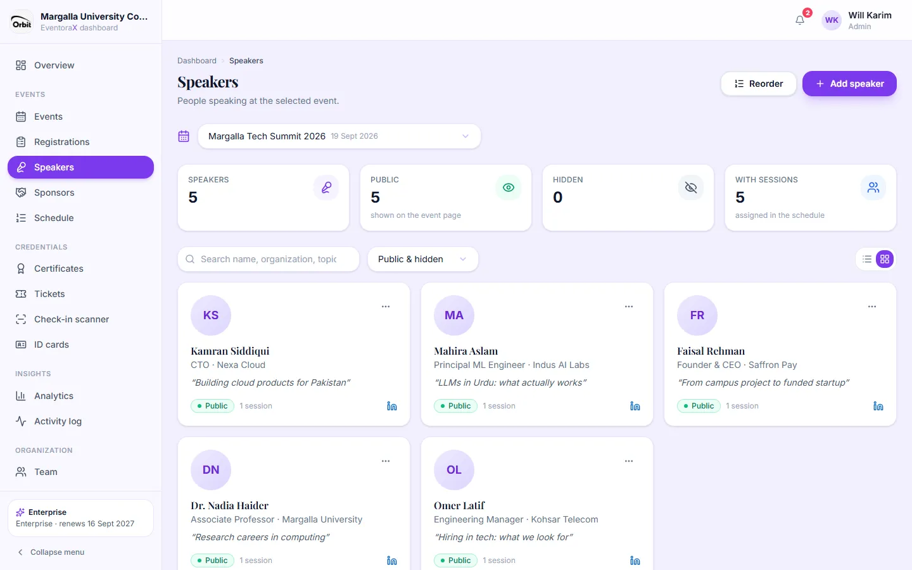
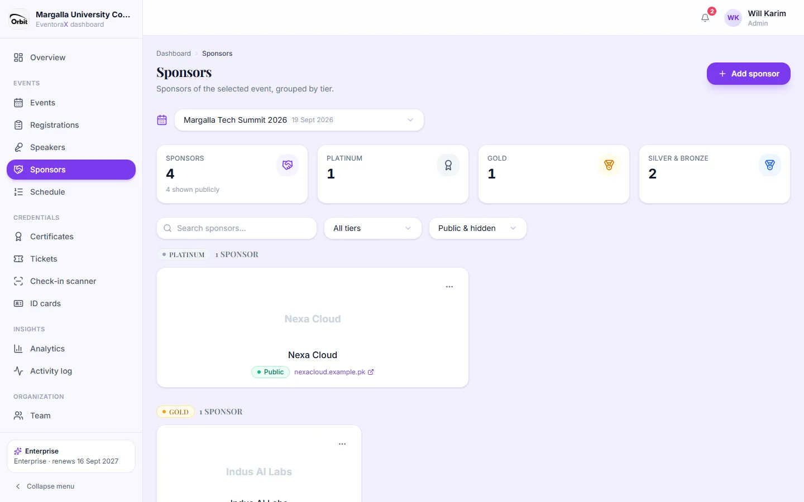
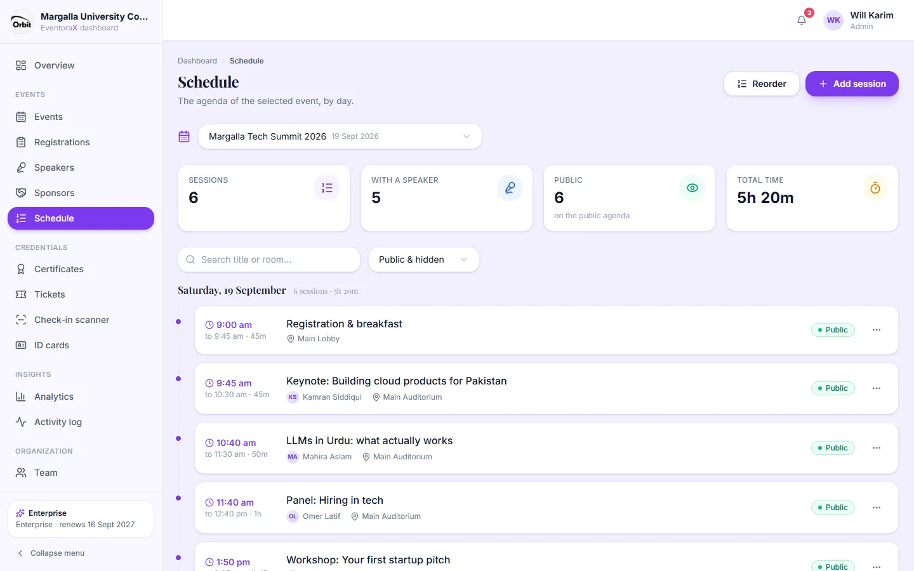

# 3. Events, speakers, sponsors and schedule

*Admins and managers can create and edit. Viewers can look.*

## Events list

**Events** in the left menu lists all your events.

- The cards at the top count upcoming, active, draft and completed events.
- The tabs filter by status: **All active**, **Draft**, **Upcoming**, **Active**, **Completed**, **Archived**.
- Search by title, topic or venue, filter by mode or date range, and switch between the list and the card view
  (buttons on the right).
- The **Registrations** column shows how full each event is.
- The **⋯** menu on each row: **Open**, **Edit**, **Duplicate** (a copy as a draft, handy for yearly events),
  **Archive** / **Restore**, and **Delete** (only for events without registrations; events with registrations are
  archived instead, so no attendee data is ever lost).

## Create or edit an event

Click **New event**. The form has five parts:

1. **Basics:** title (required), organizer (for example the department running it), topic, description, **mode**
   (Physical, Online, Hybrid) and **status**. Keep it as **Draft** while you prepare; only your team can see drafts.
   Set it to **Upcoming** to publish it and open the public page.
2. **Date & place:** start and end (required), the venue, and for online or hybrid events the meeting link (only
   attendees see it, on their ticket).
3. **Registration:** maximum attendees (empty = no limit; registration closes automatically when full), ticket price in
   PKR (empty = free, payment is handled by you), and **Registration open** (switch off to stop new sign-ups; you can
   still add people yourself).
4. **Certificates:** the certificate design for this event (**Choose design**) and **Issue certificates automatically**
   (when someone is marked Attended or their ticket is scanned, they get a Participation certificate by email).
5. **Attendee categories:** groups such as VIP, Student, Speaker. Type a name and press Enter, or click a suggestion.

Click **Create event** (or **Save changes**). Fields with a problem are marked in red with an explanation underneath.

## Event page (the event hub)

Click an event to open its hub.

- **Public page card** (only for published events): the link people use to register. **Copy link**, **QR for posters**
  (downloads a QR image to print) and **Open**. Drafts explain how to get a public page.
- **Numbers:** registered (out of the seat limit), attended, seats left, checked in.
- **Tabs:** Overview (description, categories, details), Registrations, Speakers, Sponsors and Schedule of this event.
- **Edit** and the **⋯** menu (Duplicate, Archive, Delete) are at the top right.

Archived events are read-only. Restore them to make changes.

## Speakers

People speaking at the selected event, as cards or a list.

- **Add speaker:** first and last name, job title, organization, talk or session topic, bio, photo and LinkedIn profile.
- **Public / hidden:** only public speakers appear on the public event page. Toggle it from a speaker's **⋯** menu
  (with **Undo**).
- **Reorder:** drag speakers into the order they should appear on the public page.
- The cards at the top count speakers, public, hidden and how many have a session in the schedule.

## Sponsors

The selected event's sponsors with their logo, website and **tier** (for example Platinum, Gold, Bronze). Public sponsors
appear on the event page grouped by tier. **Add sponsor** to add one; **⋯** to edit, hide or delete.

## Schedule

The agenda of the selected event, grouped by day.

- **Add session:** title, start and end time, room or location, and the speaker (from this event's speakers).
- Each session can be public or hidden, like speakers.
- **Reorder** changes the order of sessions that start at the same time.
- The cards show the number of sessions, how many have a speaker, how many are public and the total time.
