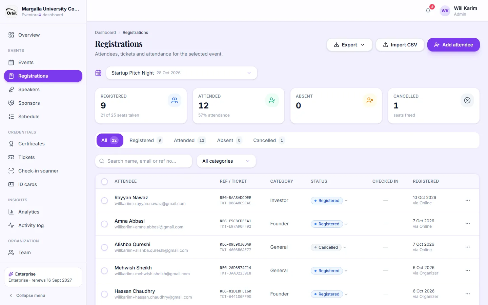
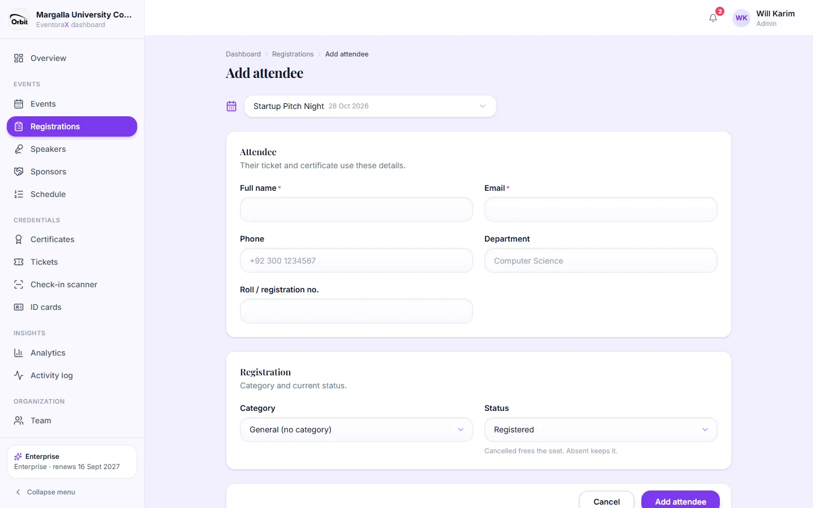
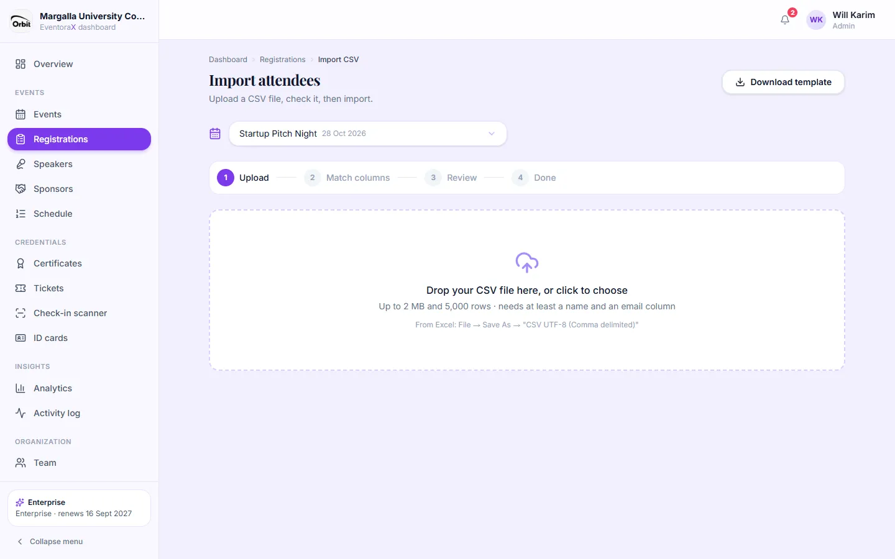

# 4. Registrations

*Admins and managers can add, import and change attendees. Viewers can look and export.*

## The attendee list

**Registrations** shows everyone registered for the event chosen in the picker at the top.

- **Cards:** registered (and seats taken out of the limit), attended (with the attendance rate), absent, cancelled.
- **Tabs:** All, Registered, Attended, Absent, Cancelled. Search by name, email or reference number; filter by category.
- **Columns:** the person, their registration number (`REG-…`) and ticket number (`TKT-…`), category, status, when they
  checked in, and when and how they registered (**Online** = the public event page, **Organizer** = added by your team,
  **CSV** = imported, **API** = from a connected system).
- **Change a status** with the small arrow next to it: Registered, Attended, Absent or Cancelled.
- **⋯ menu:** **Edit**, **Send email** (a message you write), **Cancel registration** / **Restore registration**, **Delete**.

### What the statuses mean

| Status | Meaning |
|---|---|
| Registered | Signed up, not checked in yet |
| Attended | Was there. Set automatically when their ticket is scanned. Needed for Participation and Achievement certificates. |
| Absent | Didn't come. Keeps the seat. |
| Cancelled | Frees the seat. Gets no certificate and no emails. Can be restored later if there are seats left. |

### Working with many people at once

Tick the circles at the start of rows (or the one in the header for the whole page). A bar appears with **Attended**,
**Absent**, **Email** and **More** (mark as Registered, cancel, restore, export just the selected people).

### Export

**Export** (top right) downloads the list as **Excel** or **CSV**, with the current filters applied.

## Add one attendee

Click **Add attendee**. Enter the full name and email (required), and optionally phone, department, roll or registration
number and category. Click save: the person is added and their ticket is created straight away.
Organizers can add people even when public registration is closed.

## Import from a CSV file

For many people at once, for example a list exported from Google Forms or Excel.

1. Click **Import CSV**. Optionally click **Download template** for a file with the right columns.
2. **Upload:** drop the file in the box or click to choose it (up to 2 MB and 5,000 rows; it needs at least a name and an
   email column). From Excel use *File → Save As → CSV UTF-8 (Comma delimited)*.
3. **Match columns:** EventoraX guesses which column is which (name, email, phone, department, roll number, category).
   Fix any wrong guesses.
4. **Review:** a test run shows how many rows will be added, which will be skipped and why (invalid email, already
   registered, event full). If the same email appears twice in the file, choose **Keep the first one**,
   **Keep the last one** or **Skip all copies**. Categories that don't exist yet can be created.
   Nothing is saved until you confirm.
5. **Done:** everyone added has a ticket. You can download the skipped rows as a CSV to fix and import again.
