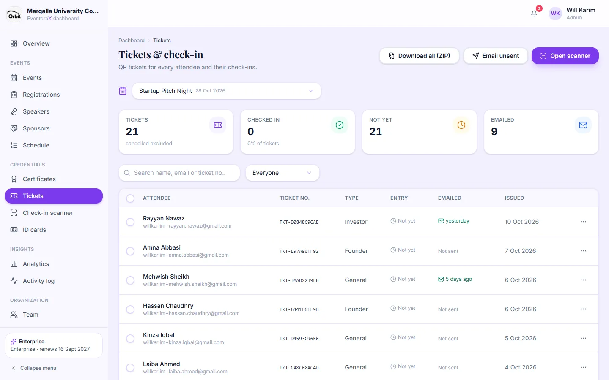
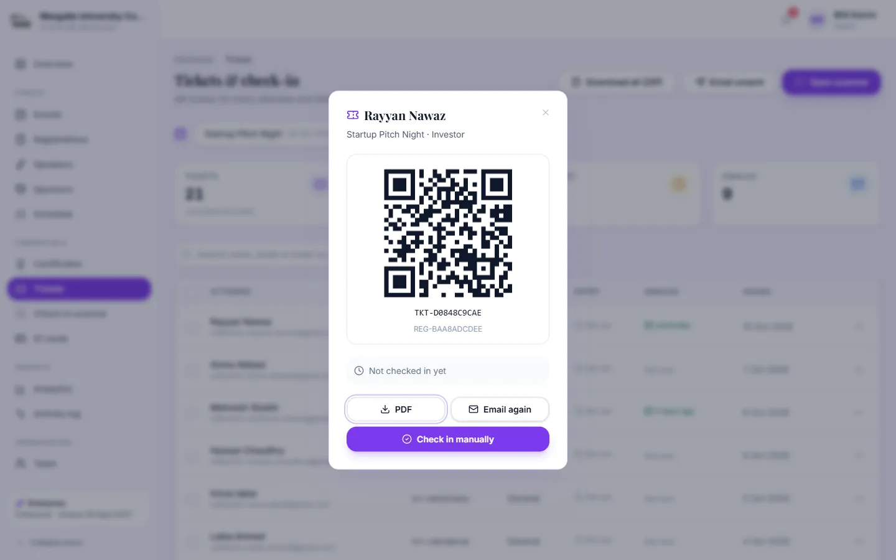
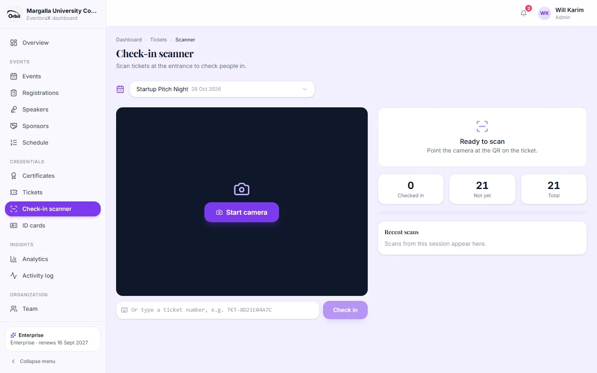

# 5. Tickets and check-in

Every registration automatically gets a ticket with a unique QR code and a ticket number like `TKT-D0848C9CAE`.

## Tickets page

**Tickets** lists the tickets of the selected event: who has checked in and when, and whether the ticket was emailed.

- Filter by checked in / not checked in and by emailed / not emailed, or search.
- **Download all (ZIP)**: every ticket as a PDF in one ZIP file, for printing.
- **Email unsent**: emails the ticket to everyone who hasn't received it yet. **Open scanner** opens the check-in scanner.
- Tick rows to **Download ZIP** or **Email selected** for just those people.
- **⋯ menu** on a row: **Show QR**, **Download PDF**, **Check in manually**, **Undo check-in**.

**Show QR** opens the ticket on screen. Useful at the door when someone forgot their phone: find them and click
**Check in manually**.

## Check-in scanner

*Admins and managers.*

Use a phone or laptop at the entrance.

1. Open **Check-in scanner** in the menu and pick the event.
2. Click **Start camera** and allow camera access when the browser asks.
3. Point the camera at the attendee's QR code (on their phone, printed ticket or ID card).
4. The panel on the right turns green with their name: they are checked in and marked **Attended**. If the event gives
   certificates automatically, their certificate is emailed.

- Scanning the same ticket again shows **already checked in** and when. The first scan counts.
- A ticket for another event is refused.
- No camera? Type the ticket number in the box under the camera and click **Check in**.
- The counters show checked in, not yet and total; **Recent scans** lists this session's scans.

> The camera only works on a secure (`https://`) website or on the computer running the app. Several phones can scan at
> the same time.
