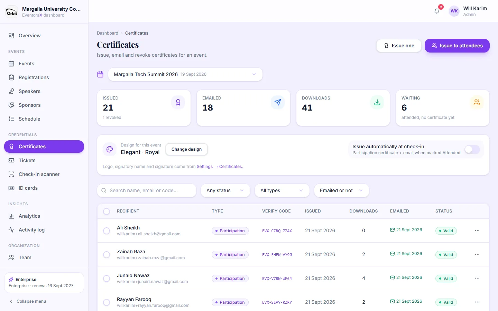
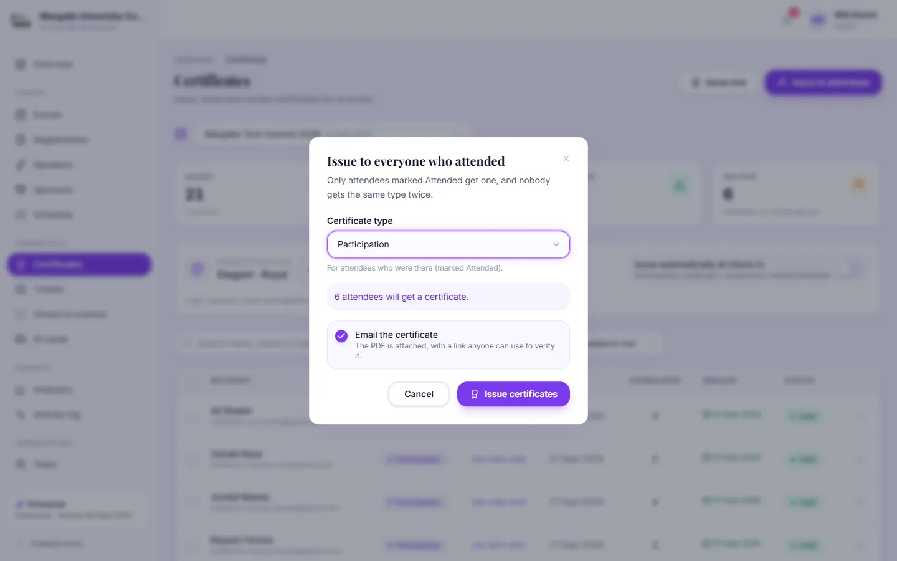
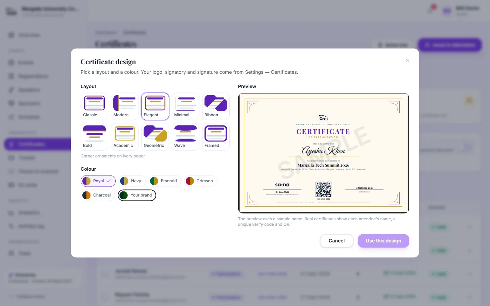

# 6. Certificates

*Admins and managers issue, email and revoke. Viewers can look and download.*

Each certificate is a PDF with the attendee's name, the event, your logo and signatory, a QR code and a unique **verify
code**. Anyone can check it on the public [verify page](01-public-pages.md#verifying-a-certificate).

## Certificate types

| Type | Who can get it |
|---|---|
| Participation | Attendees marked **Attended** |
| Achievement | Attendees marked **Attended** (winners, top performers) |
| Appreciation, Speaker, Organizer | Anyone registered who isn't cancelled |

A person gets at most **one certificate of each type** per event.

## Before you start: signatory and logo

Set these once in **Settings → Certificates** (signatory name, title and signature image) and **Settings → Branding**
(logo and colours). See [Settings](09-organization.md#settings).

## Certificates page

- **Cards:** issued (and how many revoked), emailed, downloads by recipients, and **waiting** (attended but no
  certificate yet).
- **Design for this event** with **Change design**, and the switch **Issue automatically at check-in**.
- The list: recipient, type, verify code, issue date, downloads, emailed, status (**Valid** or **Revoked**).
  Filter by status, type and emailed; search by name, email or code.
- **⋯ menu:** **View PDF**, **Download**, **Copy verify link**, **Email to attendee** (or **Email again**),
  **Revoke** / **Restore**.
- Tick rows and click **Email selected** to (re)send certificates.

## Issue certificates

**Issue to attendees** gives a certificate to everyone eligible in one go:

1. Choose the **certificate type**. The box below says how many attendees will get one.
2. Leave **Email the certificate** ticked to send each person their PDF with the verify link.
3. Click **Issue certificates**. Emails go out in the background; admins can be notified when they're done
   ([Notifications](09-organization.md#notifications)).

**Issue one** is for individual certificates (for example a Speaker certificate): search for attendees, tick them,
pick the type and issue.

**Automatic:** with **Issue automatically at check-in** on, a Participation certificate is issued and emailed the moment
someone is marked Attended or their ticket is scanned.

## Choose a design

Pick one of **10 layouts** (Classic, Modern, Elegant, Minimal, Ribbon, Bold, Academic, Geometric, Wave, Framed) and a
**colour** (Royal, Navy, Emerald, Crimson, Charcoal, or **Your brand** colours). The preview shows a sample certificate.
Click **Use this design**. The design applies to certificates issued from now on.

## Revoke and restore

If a certificate was issued by mistake: **⋯ → Revoke**, enter a reason, confirm. The certificate is kept, but the
verify page now shows **REVOKED** with your reason. **Restore** makes it valid again.
