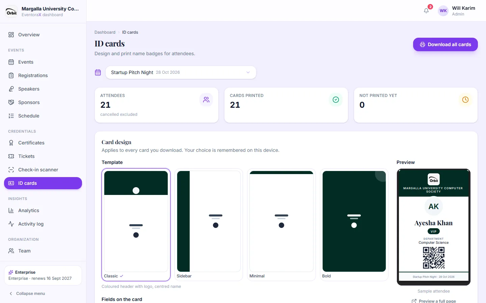

# 7. ID cards

*Everyone, including viewers, can print ID cards.*

Name badges for attendees, ready to print and cut. The QR code on the card is the attendee's ticket, so a badge can be
scanned at the door with the [check-in scanner](05-tickets-and-check-in.md#check-in-scanner).

1. Open **ID cards** and pick the event.
2. **Card design:**
   - **Template:** Classic (coloured header with logo), Sidebar (coloured band on the left), Minimal (white with a thin
     line) or Bold (full colour). Colours come from Settings → Branding.
   - **Fields on the card:** name and event are always printed; choose category, department, roll number, email and
     the QR code. Optionally your logo.
   - **Layout:** **9 cards per A4 page** with cut marks (normal printer) or **one card per page** (card printers).
   - The **Preview** shows a sample card; **Preview a full page** opens a whole sheet.
   Your design choice is remembered on this computer.
3. Print:
   - **Download all cards** for everyone (or for everyone matching your filters).
   - Tick some people and **Download selected cards**.
   - **⋯ → Download card** for one person; **View card** only looks at it.

The cards at the top show attendees, cards printed and **not printed yet**. Use the filter "Not printed yet" to print
only latecomers. Downloading counts as printed; viewing doesn't.

- Cards are the standard ID-card size (54 × 85.6 mm, portrait). Long names shrink to fit.
- There are no photos: cards show the person's initials in a circle.
- Cancelled registrations don't get cards.
