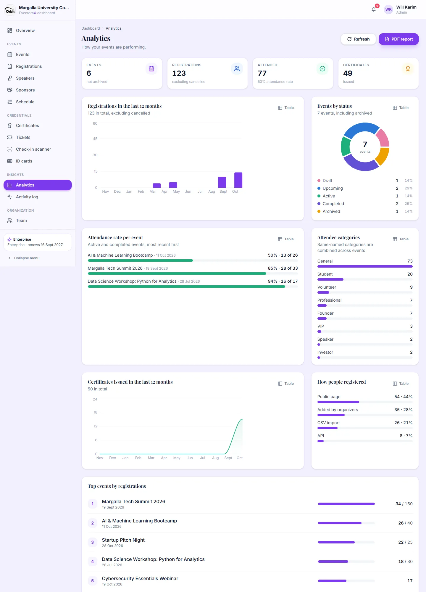
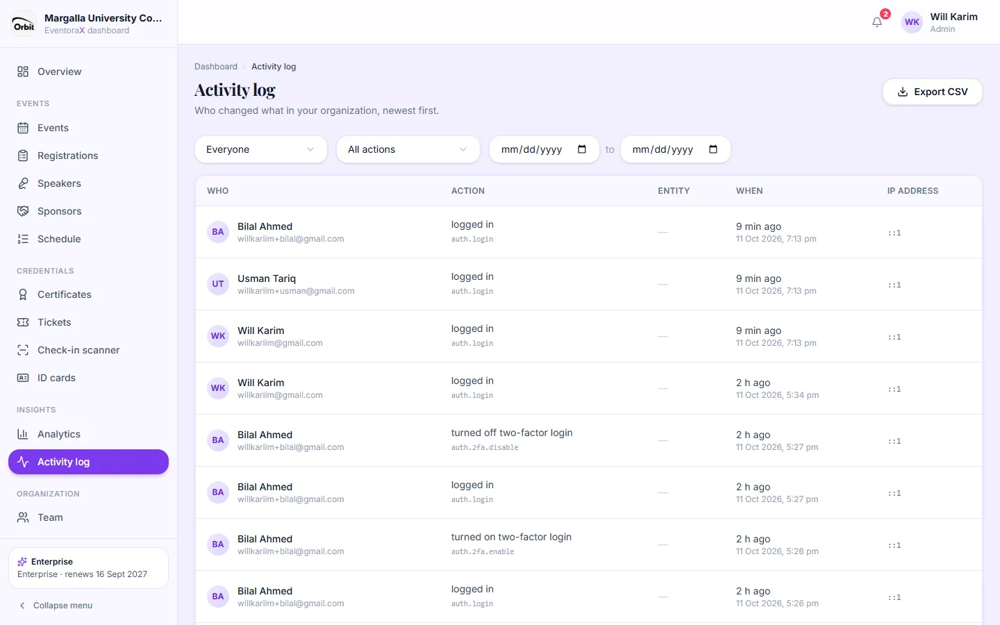

# 8. Analytics and activity log

## Analytics

*Everyone in the organization.*

How your events are doing, across all events: totals, registrations per month for the last 12 months, events and
registrations by status, attendance rate per event, categories, how people registered (public page, organizer, CSV,
API), certificates per month and your top events.

**PDF report** (top right) downloads the same numbers as a 2-page PDF with your logo, for sharing with a department head
or sponsor.

## Activity log

*Admins only.*

Everything your team did, newest first, in plain sentences: who created or edited events, imported attendees, issued or
revoked certificates, changed settings, logged in, and so on. Filter by person, type of action and date range, and
**Export CSV**.

Actions done by the EventoraX team while helping you ("log in as") are marked as such. Actions done through the API show
the token's name.
