# 9. Your organization

## Team

*Everyone can see the team. Only admins can invite, change roles or remove people.*

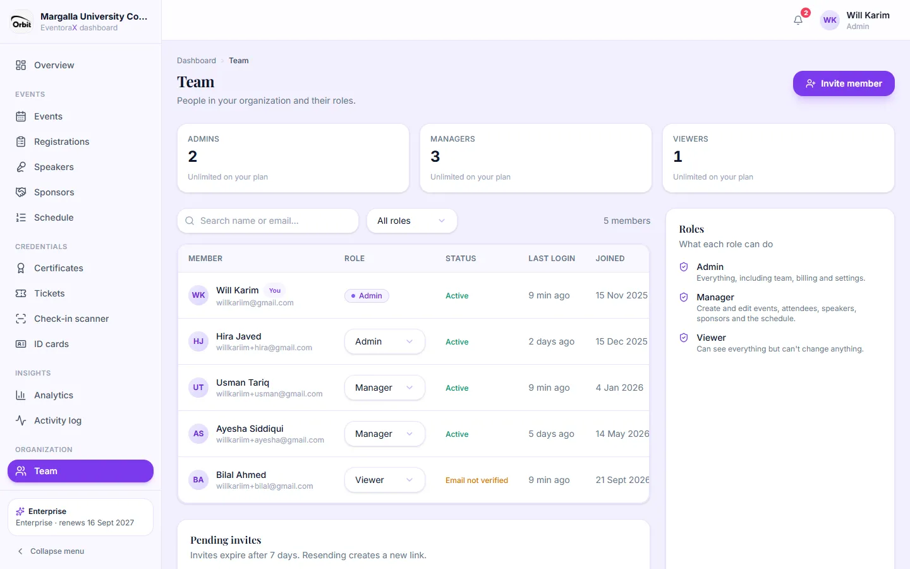

The cards count admins, managers and viewers and show your plan's limit for each. The list shows each member's role,
status (for example "Email not verified"), last login and join date. The **Roles** panel explains what each role can do
(see the [role table](README.md#what-each-role-can-do)).

- **Change a role:** pick a new one from the member's role menu. A message with **Undo** appears for a few seconds.
  You can't change your own role, and the organization must always keep at least one admin.
- **Remove from team:** from the member's **⋯** menu, after confirming. Their account is deleted (what they did stays in
  the activity log); you can invite them again later.
- **Pending invites** (below the list): **Resend** (sends a fresh link) or cancel an invite.

### Invite someone

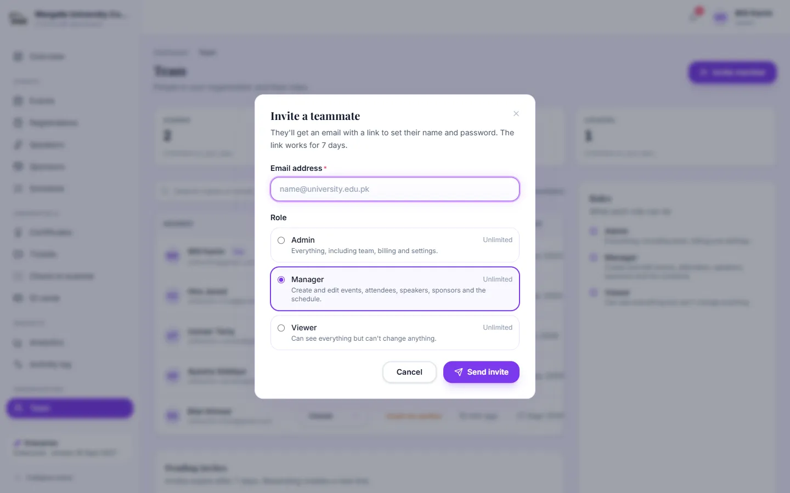

1. Click **Invite member**.
2. Enter their email address and choose **Admin**, **Manager** or **Viewer**. Each option shows how many more your plan
   allows (Pro: up to 3 admins and 7 managers; viewers are always unlimited).
3. Click **Send invite**. They get an email with a link to set their name and password, valid for 7 days.

---

## Settings

The tabs are kept in the page address. A dot on a tab means it has unsaved changes. Non-admins only see **My account**.

### My account

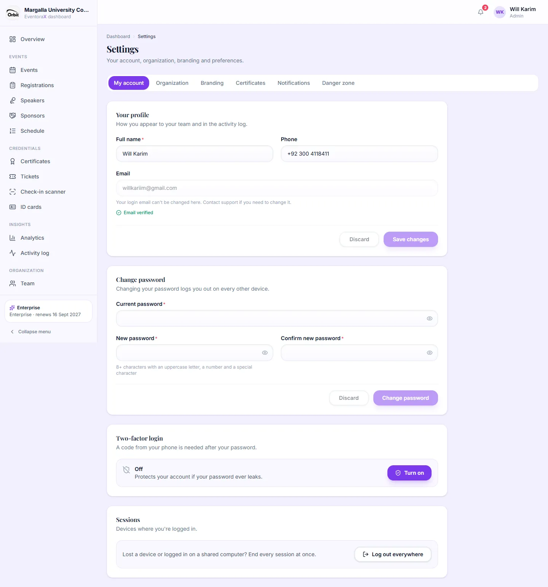

- **Your profile:** name and phone. Your login email can't be changed here (contact support).
- **Change password:** current password, then the new one twice. Every other device is logged out.
- **Two-factor login:** extra protection. Even with your password, nobody can log in without your phone.
  1. Click **Turn on**.
  2. Scan the QR code with an authenticator app (Google Authenticator, Microsoft Authenticator, Authy…).
  3. Type the 6-digit code the app shows.
  4. **Save the 10 recovery codes** (Copy or Download). Each works once if you lose your phone. They are shown only once.

  From now on, login asks for the code after your password. Turning it off or making new recovery codes asks for your
  password. Lost both the phone and the codes? Ask the EventoraX team to reset it.
- **Sessions:** **Log out everywhere** ends every session, for example after using a shared computer.

### Organization

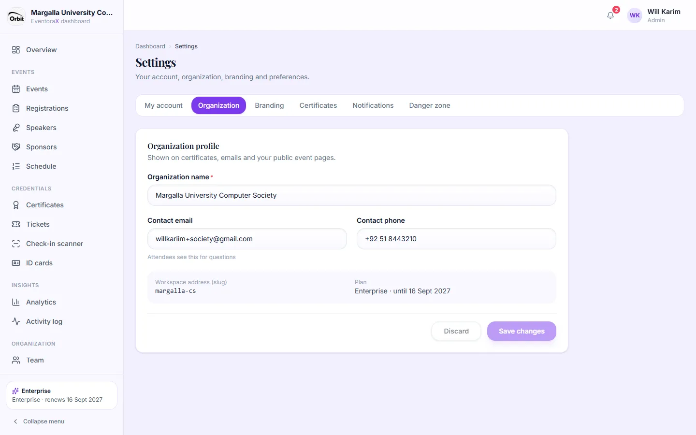

Organization name, and the contact email and phone attendees see for questions. Also shows your organization's address
(slug, used in `/o/<slug>`) and your plan.

### Branding

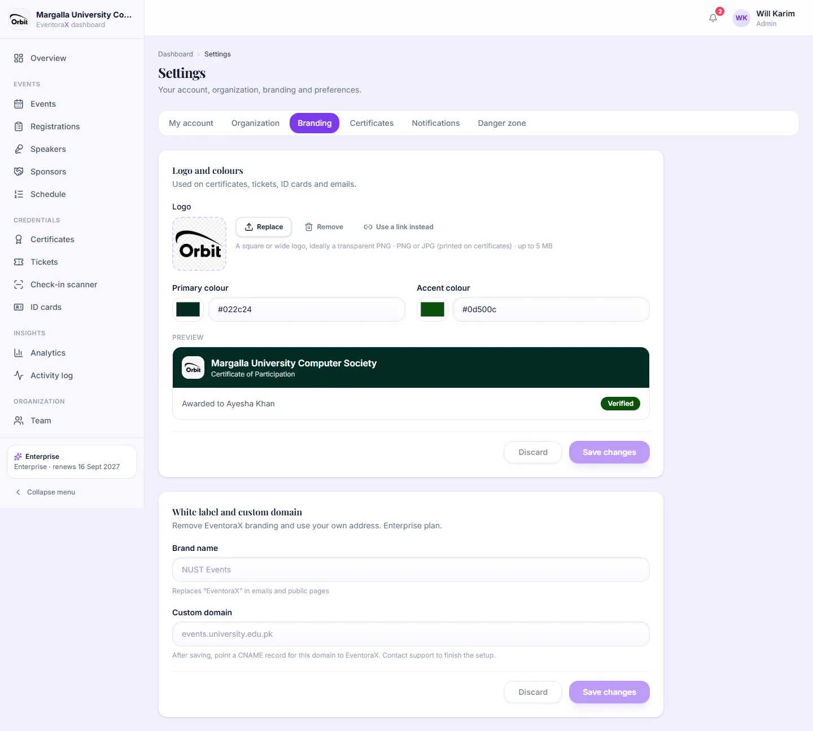

- **Logo** (PNG or JPG, because it's printed on PDFs) and **primary** and **accent colours**. Used on certificates,
  tickets, ID cards, emails and your public pages. A preview shows how it looks.
- **White label and custom domain** (Enterprise plan): a brand name that replaces "EventoraX" in emails and public pages,
  and your own web address (contact support to finish the setup).

### Certificates

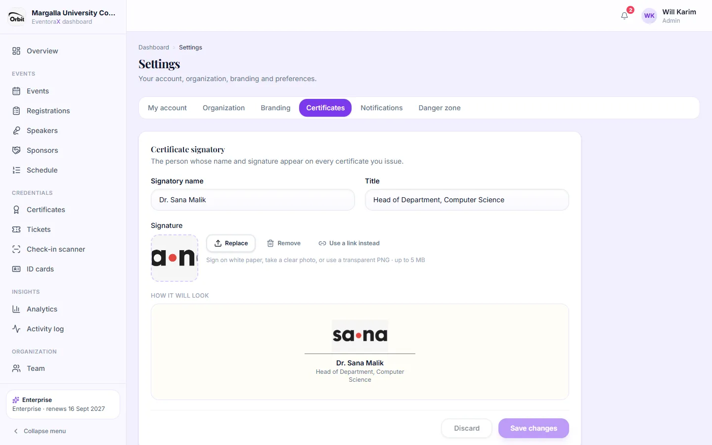

The **signatory** printed on every certificate: name, title and a signature image (sign on white paper and take a clear
photo, or upload a transparent PNG). The preview shows how it will look.

### Notifications

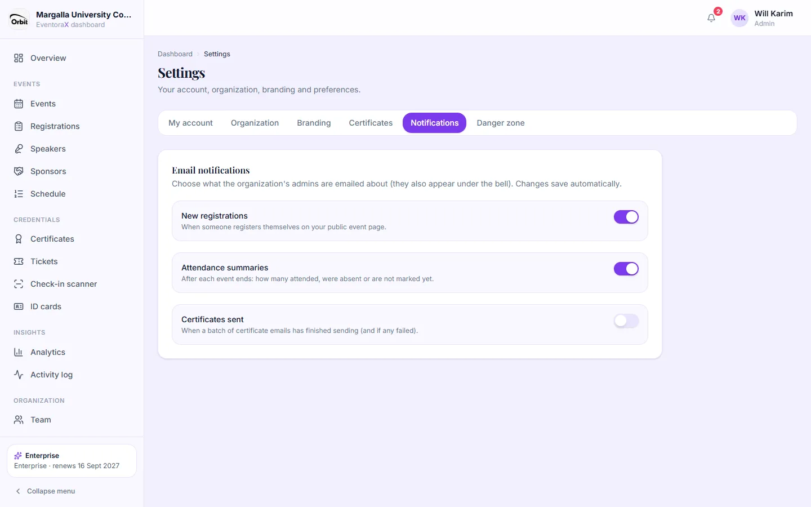

Choose what admins are emailed about (they also appear under the bell). Changes save automatically.

- **New registrations:** someone registered on your public event page.
- **Attendance summaries:** after each event ends: how many attended, were absent or not marked yet.
- **Certificates sent:** a batch of certificate emails has finished (and whether any failed).

### Danger zone

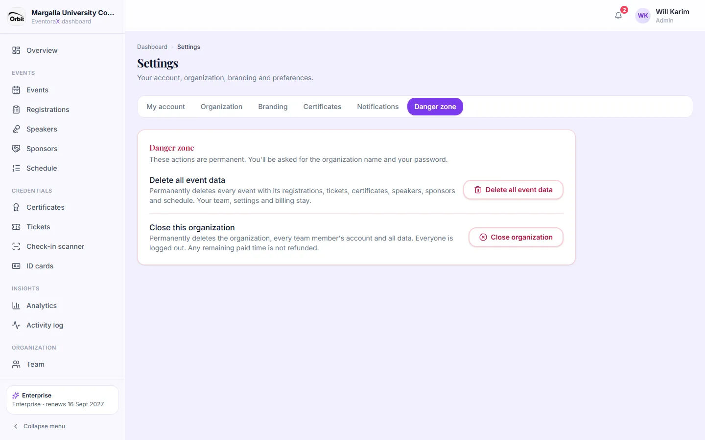

Both actions are permanent and ask for the organization's name and your password.

- **Delete all event data:** removes every event with its registrations, tickets, certificates, speakers, sponsors and
  schedule. Your team, settings and billing stay.
- **Close organization:** deletes the organization, every member's account and all data. Remaining paid time is not refunded.

---

## Billing

*Admins only.*

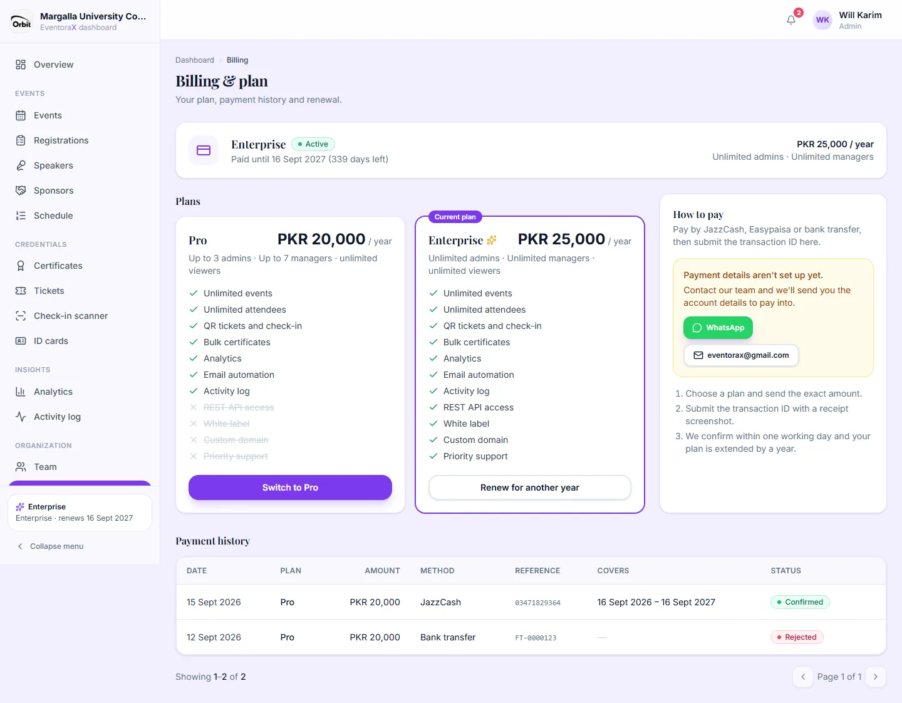

Your current plan, its status and end date, the available plans with prices and features, how to pay, and your
payment history.

**How to pay (renew or upgrade):**

1. Send the plan's yearly price by **JazzCash**, **Easypaisa** or **bank transfer** to the accounts shown under
   **How to pay**. (If none are shown, contact the team using the WhatsApp or email buttons.)
2. Click **Renew for another year** (or **Pay for …** / **Switch to …**).

   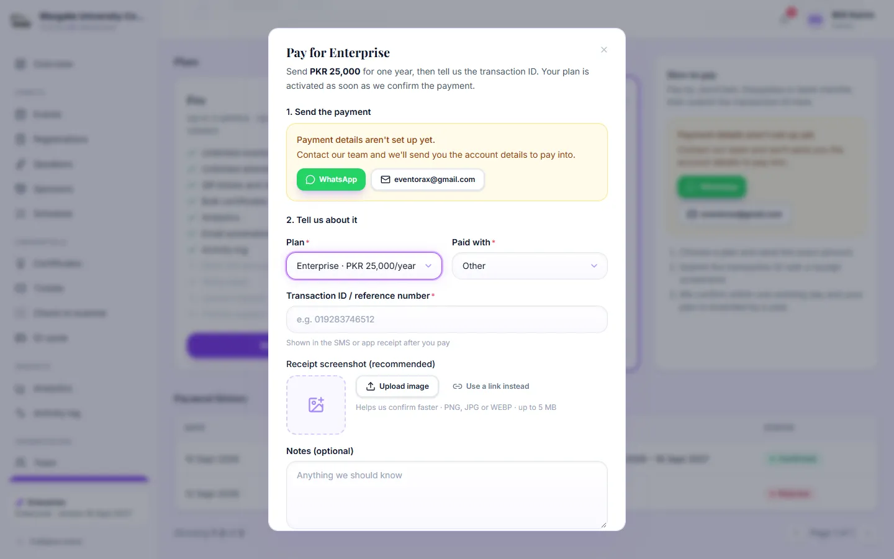

3. Choose the plan and how you paid, enter the **transaction ID** from your SMS or app receipt, upload a **screenshot of
   the receipt** (recommended) and add a note if needed. Submit.
4. The payment shows as **Pending**. The EventoraX team checks it, usually within one working day. When it's confirmed
   you get an email and your plan runs for another year: from your current end date if a paid plan is still running
   (renewing early never loses days), otherwise from the day it's confirmed.
   If it's rejected, the reason is shown under the payment.

You can cancel a pending payment you submitted by mistake. Billing keeps working even after your plan has expired.

---

## API (Enterprise plan)

*Admins only.*

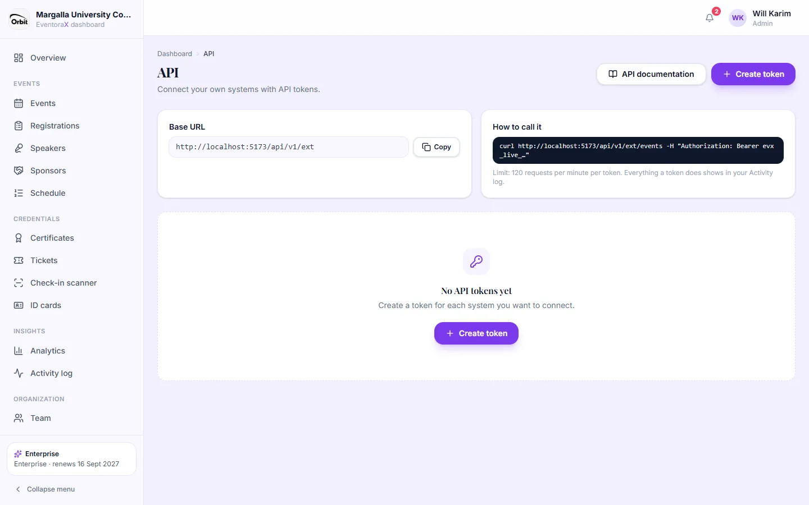

Lets your own systems (a university portal, a form tool) read events and registrations, register people, check them in
and look up certificates. On other plans this page explains that the API is part of Enterprise.

1. Click **Create token**, give it a name (for example "Student portal") and an expiry (30, 90 or 365 days, or never).
2. **Copy the token now.** It starts with `evx_live_` and is shown only once.
3. Give it to the developer together with the **API documentation** link.
4. **Revoke** a token to stop it immediately.

Everything a token does appears in the Activity log with the token's name.

---

## Help & support

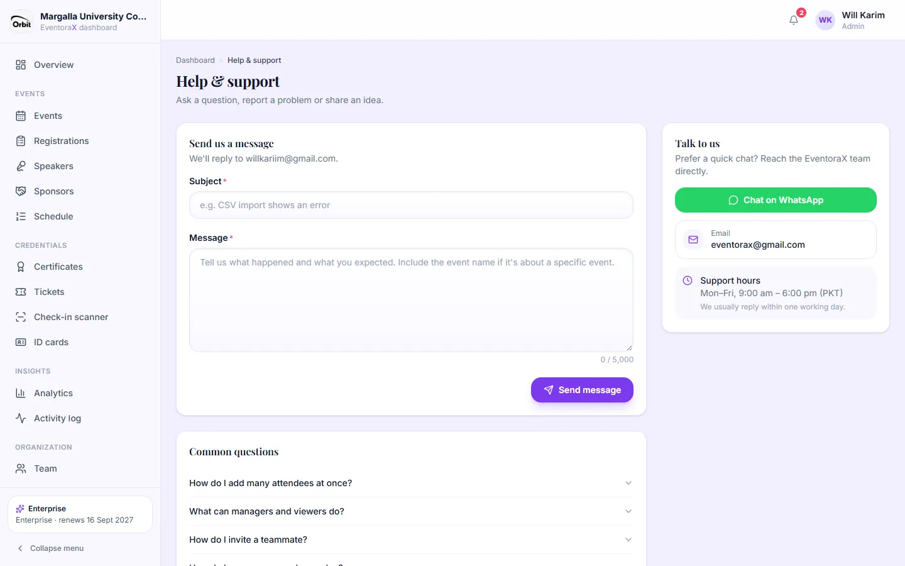

Send the EventoraX team a message (we reply to your login email), chat on WhatsApp, or read the common questions.
